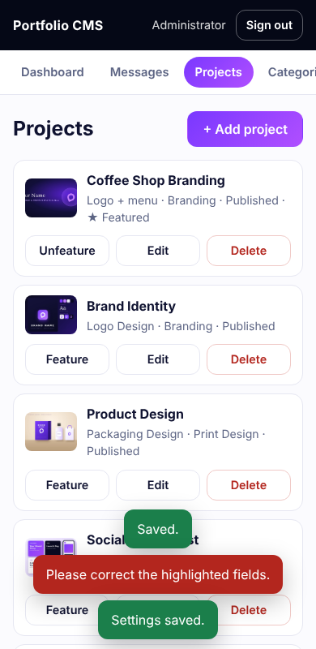
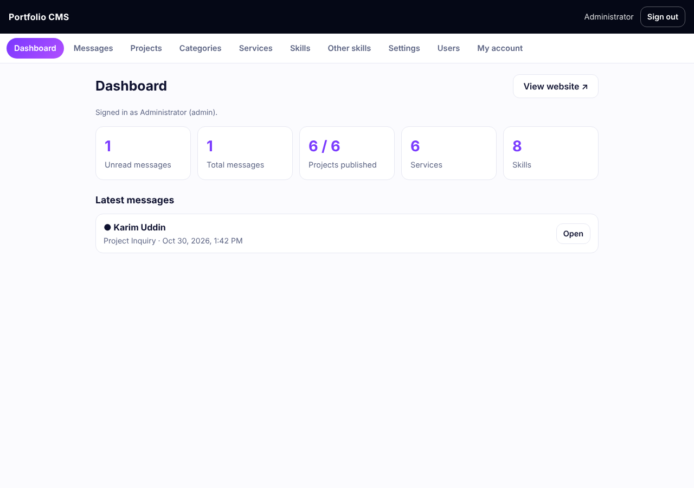

# Creative Portfolio CMS

A **complete portfolio website with a built-in admin panel** for designers, freelancers and creative studios. Visitors see a polished, responsive single-page portfolio; you sign in to `/admin/` to manage everything — projects, categories, services, skills, site texts, photos, social links — and read the messages visitors send through the contact form. No code editing is needed to run your site.

Built with **Node.js (built-in HTTP server) + SQLite + vanilla JavaScript**. **Zero third-party dependencies**: no `npm install`, no build step, no CDN requests, no tracking.

> **Important — live demo and GitHub Pages:** GitHub Pages only hosts static files; it cannot run this CMS's Node.js API, admin authentication, or SQLite database. The existing `https://tabassumnisha.github.io/Portfolio-Template/` link is therefore a static frontend preview, not a working CMS demo. For Vibe96 review, deploy this full package to a Node.js 22.13+ host with persistent storage, then provide a separate demo login through the marketplace form. Never put demo or production credentials in this public repository.

| Website | Admin panel (mobile) |
|---|---|
|  |  |



---

## What you get

**Public website** (`/`)
- Hero, About, Services, Portfolio gallery with category filters, Skills, Featured project and Contact sections
- Every text, image, project, service and skill comes from the database; nothing is hard-coded
- Contact form that saves messages to your private inbox, plus prefilled WhatsApp buttons
- Responsive from 320 px phones to wide desktops, keyboard accessible, reduced-motion aware

**Admin panel** (`/admin/`)
- Secure sign-in, sign-out and change-password
- Dashboard with unread-message count and quick stats
- **Projects**: add/edit/delete, upload images, publish/hide, choose the featured project
- **Categories, Services, Skills, Other skills**: full add/edit/delete with ordering
- **Messages inbox**: read, mark unread, reply by e-mail, delete
- **Site settings**: name, role, intro, about, photos, contact details, social links, page texts
- **Users and roles**: `admin` (everything) and `editor` (content and messages only)

## Quick start (3 minutes)

Requires **Node.js 22.13 or newer** (`node -v`).

```bash
cp .env.example .env          # then set ADMIN_EMAIL and ADMIN_PASSWORD (10+ characters) in .env
npm start
```

Open http://localhost:3000 for the website and http://localhost:3000/admin/ to sign in. After the first start, **delete the `ADMIN_PASSWORD` line** from `.env`. Full guide (VPS, Docker, HTTPS, backups): [HowToSetup.md](HowToSetup.md).

## What is in the package

```text
server/            HTTP server, API routes, authentication, uploads (plain Node.js, no packages)
database/          schema.sql (tables, keys, indexes) and seed.sql (placeholder sample content)
Project/           the website (index.html, css/, js/, assets/) and the admin panel (admin/)
test/              automated API and security tests  ->  npm test
docs/              customisation guide, API reference, screenshots
.env.example       every setting, with safe placeholders
Dockerfile · docker-compose.yml
README.md · HowToSetup.md · CLAUDE.md · CHANGELOG.md · LICENSE-NOTE.md
```

## Public demo deployment

`render.yaml` is included as a deployment blueprint for a Node.js web service with a persistent SQLite/uploads disk. Import the repository into Render, review the service plan and disk cost, set `ADMIN_EMAIL` and `ADMIN_PASSWORD` as private environment variables, and deploy. Do not publish those credentials in this repository. After deployment, verify `/api/health`, sign in at `/admin/`, replace sensitive or placeholder content as needed, and provide the reviewer login through Vibe96's private submission form. A running GitHub Pages URL is only a static preview and does not satisfy the CMS demo requirement.

## Security model

- Passwords are hashed with **scrypt** (per-user salt). Sessions are random tokens stored only as SHA-256 hashes; the cookie is `HttpOnly` and `SameSite=Strict` (and `Secure` over HTTPS).
- **Every endpoint that creates, updates or deletes data requires a signed-in user and a CSRF token.** Only two writes are public by design: the contact form (rate limited, validated, honeypot) and the sign-in itself (rate limited). `npm test` proves this by walking the whole route table.
- Roles are enforced on the server: editors cannot change settings or manage users.
- All SQL uses bound parameters; all output in the admin panel and website is set with `textContent`; a strict Content-Security-Policy (`script-src 'self'`) is sent with every page.
- Uploads are accepted only if the file's bytes are a real JPG, PNG, WebP or GIF (SVG and HTML are refused) and are stored under random names.
- No credentials ship in the package: the first admin comes from your own `.env`.

## Tests

```bash
npm test      # 16 automated tests: auth, roles, CSRF, validation, uploads, rate limiting, path traversal
```

## Browser support
Current Chrome, Edge, Firefox and Safari (desktop and mobile).

## Placeholders and privacy
The sample content (`Your Name`, `+10000000000`, `hello@example.com`, `https://example.com/...`) is placeholder text in `database/seed.sql`. Visitor messages contain the name, e-mail and text a visitor typed; they are stored only in your database and never sent anywhere else. No cookies are set for visitors; the only cookie is the admin session cookie.

## Licence
Standard Licence — one end product per licence. Details and asset sources: [LICENSE-NOTE.md](LICENSE-NOTE.md). © 2026 Tabassum Nisha.
