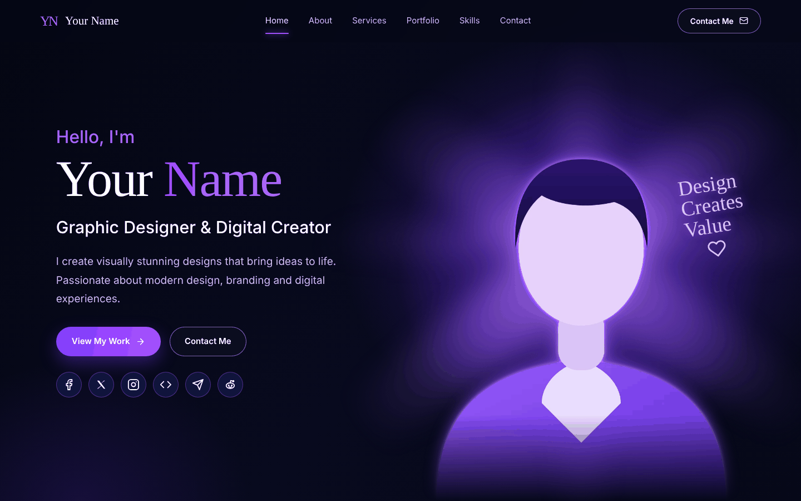
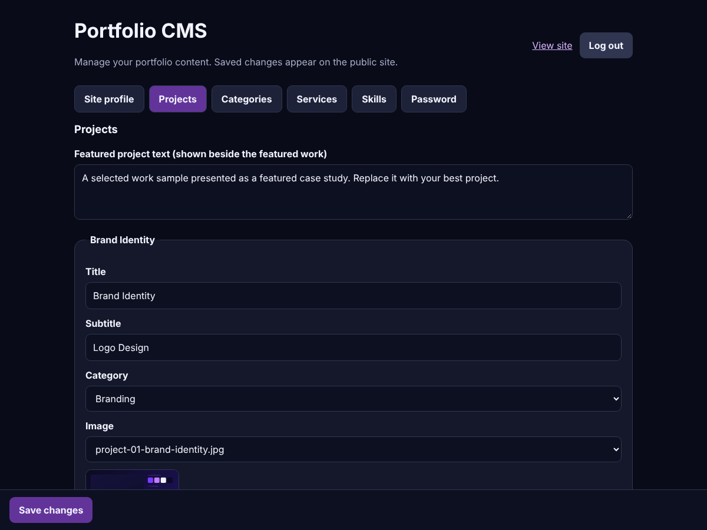
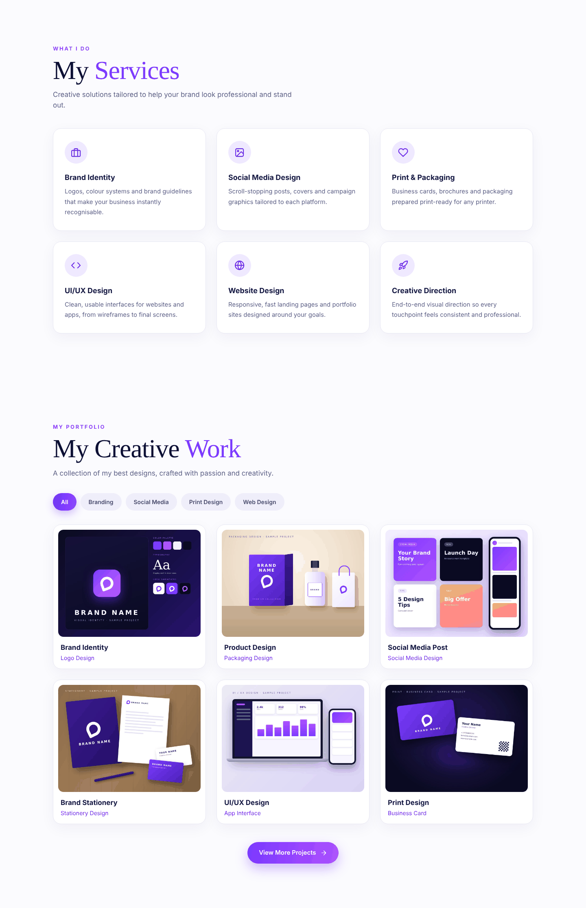
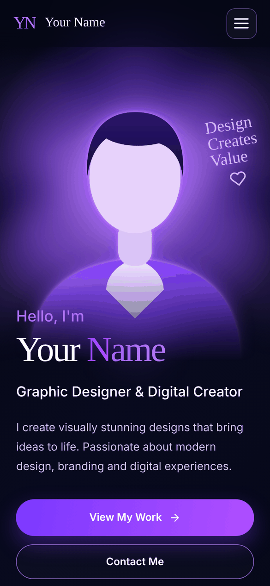
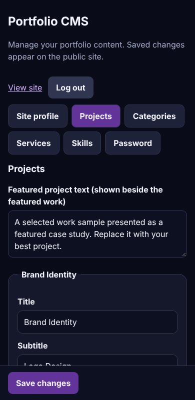

# Responsive Creative Portfolio CMS

A responsive single-page portfolio website for designers, freelancers and creative studios, **with a built-in admin panel**. Visitors see a polished portfolio (project gallery with category filters, services, about, skills, contact, WhatsApp inquiry). You sign in to `/admin/` to change everything without touching code: texts, photos, projects, categories, services, skills, contact details and social links.

Built with HTML5, CSS3 and vanilla JavaScript on the front end and a **Python standard-library server with SQLite** on the back end. **Zero third-party dependencies**: nothing to install with pip or npm, no build step, no CDN, no tracking.

| Website | Admin panel |
|---|---|
|  |  |



Mobile:  

**Live demo:** the public demo URL and demo sign-in are shown on the marketplace listing where you bought this product.

## Who is it for?
- Designers, UI/UX designers, illustrators and brand designers who want to update their own portfolio
- Freelancers and studios that need a fast, private site they fully own
- Developers who want a clean, dependency-free starter for a client's portfolio with a ready admin area

## Features
**Public website** (`/`)
- Hero, About, Services, Portfolio gallery with keyboard-operable category filters, Skills, Featured project and Contact
- WhatsApp inquiry flow: buttons and the contact form open `wa.me` with a prefilled message; visitor data is never stored
- Responsive from 320 px phones to wide desktops, mobile menu, skip link, alt text, visible focus, reduced-motion support
- Every text, image, project, service and skill comes from the database

**Admin panel** (`/admin/`)
- Secure sign-in (PBKDF2 password hashing, signed `HttpOnly` session cookie, sign-in throttling), sign-out and password change
- Edit the site profile: name, role, texts, photos, contact details, social links, page texts
- Projects: add, edit, reorder, delete, choose the featured project, upload images (JPG, PNG, WebP, GIF up to 3 MB)
- Categories, services, skills and tags with full add / edit / reorder / delete
- Changes are validated on the server and go live as soon as you press **Save changes**

**Deployment**: run with `python3 server.py` on a VPS, or `docker compose up --build -d`. Guide: [HowToSetup.md](HowToSetup.md).

## Quick start (3 minutes)
Requires Python 3.10 or newer (`python3 --version`).

```bash
cp .env.example .env      # then set ADMIN_EMAIL, ADMIN_PASSWORD (14+ characters) and SESSION_SECRET in .env
python3 server.py
```

Open http://127.0.0.1:8080 for the website and http://127.0.0.1:8080/admin/ to sign in. After the first start, delete the `ADMIN_PASSWORD` line from `.env`. Generate the secret with `python3 -c "import secrets; print(secrets.token_hex(32))"`.

## What is in the package
```text
server.py            HTTP server, API routes, sign-in, sessions, uploads (Python standard library)
validation.py        validation of portfolio data and site configuration
uploads.py           image type detection and safe file names
Project/             the website (index.html, css/, js/, assets/) and the admin panel (admin/)
database/            schema.sql (creates the database from scratch), seed.sql (demo records), default-*.json (initial content)
tests/               automated tests            ->  python3 -m unittest discover -s tests -v
docs/                customisation guide, API reference, screenshots
Dockerfile, docker-compose.yml, .env.example
README.md, HowToSetup.md, CLAUDE.md, CHANGELOG.md, LICENSE-NOTE.md
```

## Security model
- Every route that creates, updates or deletes data requires a signed-in administrator, the admin role and the `X-Portfolio-Action` header (anti-CSRF); anonymous requests get 401/403. Test-covered.
- Passwords are stored as salted PBKDF2-HMAC-SHA256 hashes; sessions expire after 8 hours; 8 failed sign-ins per 5 minutes per address are throttled.
- All SQL uses bound parameters. Uploads are accepted only as real JPG/PNG/WebP/GIF files (checked by file signature), size-limited, stored under random names.
- Strict Content-Security-Policy, `nosniff`, frame and referrer headers. Data is rendered with `textContent`, never `innerHTML`.
- No default password ships. The first administrator is created from your own `.env`.
- This is a small single-admin CMS. Use HTTPS (`COOKIE_SECURE=true`) in production, back up the `data/` folder, and add proxy-level rate limiting for busy public sites.

## Tests
```bash
python3 -m unittest discover -s tests -v
```
Covers validation rules, password hashing, sign-in and throttling, anonymous write denial, CSRF header, uploads and content saving.

## Browser support
Current Chrome, Edge, Firefox and Safari (desktop and mobile).

## Placeholders and privacy
Names, phone numbers, e-mails and links in the demo content are placeholders (`+10000000000`, `hello@example.com`, `https://example.com/...`). Replace them in the admin panel.

## Licence
Standard Licence by Ride Bangla Limited; see [LICENSE-NOTE.md](LICENSE-NOTE.md) for the terms and the list of bundled assets.
