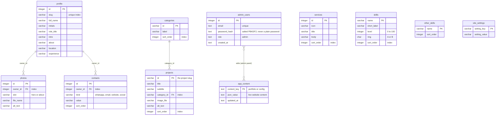

# Entity relationship diagram

Single-owner model: one `profile` row is the owner of the portfolio. `photos` and `contacts` belong to it through `owner_id`.
Everything else is portfolio content. The running website reads the JSON in `app_content`; the relational tables mirror the default content and are the clean starting point if you move to Firebase, Supabase or PostgreSQL.

## Tables
| Table | Purpose | Written by |
|---|---|---|
| `profile` | The portfolio owner: name, role, texts, location | seed, reference |
| `photos` | Hero and about photos of the owner (`owner_id` to `profile`) | seed, reference |
| `contacts` | WhatsApp, e-mail, website and social links of the owner (`owner_id` to `profile`) | seed, reference |
| `categories` | Gallery filter buttons | seed, reference |
| `projects` | Gallery items; `id` is the project's slug; `category_id` to `categories` (`ON DELETE RESTRICT`) | seed, reference |
| `services` | The services section | seed, reference |
| `skills`, `other_skills` | Skill rings and extra skill tags | seed, reference |
| `site_settings` | Featured project id and text | seed, reference |
| `admin_users` | The administrator account (one owner) | first start, password change |
| `app_content` | **Live content as JSON** (`portfolio`, `config`) | admin panel (`PUT /api/admin/content/...`) |

There is no `sessions` table: a session is an HMAC-signed `HttpOnly` cookie (see `database/schema.sql`).
